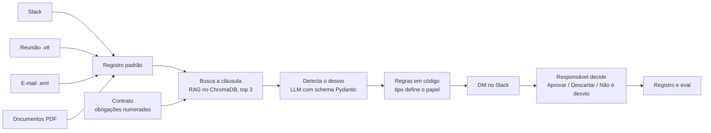

# Radar de Desvios

> Nome provisório. Projeto do Hackathon ETEG 2026.

O Radar de Desvios cruza o que a ETEG combinou **em contrato** com o que acontece **na execução do projeto** (Slack, reuniões, e-mails e documentos de terceiros). Quando algo sai do combinado, ele avisa por DM no Slack a pessoa certa, citando o trecho do contrato e o trecho da conversa lado a lado. Nada é registrado sem uma pessoa aprovar.

- **Desafio declarado:** Conformidade documental de terceiros, adaptado ao processo interno da ETEG.
- **Técnicas:** RAG e graph engineering (extras: extração em lote e entrada multimodal com PDFs; MCP, se sobrar tempo).
- **Critérios de qualidade:** observabilidade, evals, human-in-the-loop e saída validada por schema.
- **Dados:** somente base sintética. Nenhum dado real da ETEG ou de cliente.

---

## O problema

O desvio só aparece tarde: a feature entregue fora do escopo, o prazo prometido que estourou, o terceiro trabalhando sem o documento exigido, a promessa feita em reunião que não está no contrato. Ninguém cruza contrato com conversa, e cada área olha só a sua parte.

Números do deck do hackathon: 13.813 documentos de terceiros pendentes no CSC de RH da Coca-Cola FEMSA e 4.800 terceiros bloqueados. Pela Súmula 331 do TST, a contratante responde pelo que não fiscalizou.

## Como funciona

1. **Lê o contrato** e transforma as obrigações em lista estruturada, com o número de cada cláusula.
2. **Lê a execução do projeto:** Slack, transcrição de reunião, e-mails (.eml) e documentos do terceiro (PDF).
3. **Compara** cada evidência com as obrigações e decide se há desvio, de que tipo e com que confiança.
4. **Avisa** o responsável por DM no Slack, com contrato e evidência lado a lado, e espera a pessoa **Aprovar**, **Descartar** ou marcar **Não é desvio**.



As regras em código escolhem o responsável e o canal. A confiança define a ação: **0,8 ou mais** vai por DM, **de 0,5 a 0,8** entra no resumo e **abaixo de 0,5** é descartado e fica só no traço. O campo `responsavel` nunca é preenchido pelo modelo.

## Os 4 desvios da demo

| # | Desvio | Onde aparece | O que o contrato diz | Vai para |
|---|--------|--------------|----------------------|----------|
| 1 | Feature fora do escopo | Slack: o cliente pede um módulo extra e alguém responde "a gente faz" | Cláusula de escopo com a lista de módulos | Gestor do projeto |
| 2 | Prazo ou SLA contrariado | E-mail e Slack: entrega remarcada para depois do prazo | Cláusula de prazo e SLA | Comercial |
| 3 | Terceiro sem documento | PDF do ASO vencido e mensagem "o João começa amanhã" | Cláusula de obrigações do terceiro | Administrativo de contratos e jurídico |
| 4 | Promessa fora do contrato | Reunião: "a gente inclui o treinamento sem custo" | Nada no contrato cobre a promessa | Administrativo de contratos |

O desvio 3 é a ponte com o desafio declarado (conformidade documental de terceiros) e **precisa aparecer na demo**.

## Fontes de dados

Todas as fontes passam pela mesma interface: um `fetch()` que devolve `Registro` com origem, data, autor, texto e link. Se um conector falhar no pitch, troca-se para leitura de arquivos sem mexer no resto.

| Fonte | Na demo | Futuro |
|-------|---------|--------|
| Slack | Workspace gratuito de teste, app interno (Bolt for Python, Socket Mode) | O mesmo app no workspace da ETEG |
| Reunião (Meet) | Gravação encenada de 2 a 3 min transcrita com faster-whisper; plano B: `.vtt` sintético | API do Meet |
| E-mail | Arquivos `.eml` sintéticos | Gmail API com OAuth |
| Documentos do terceiro | 3 PDFs sintéticos: ASO vencido, guia de FGTS ausente, certidão válida | Anexos de e-mail e pasta do Drive |
| Contrato | 1 contrato sintético ("Projeto Alfa"), 6 a 10 páginas, cláusulas numeradas | Contratos reais do jurídico |

## Stack

Python 3.11 de ponta a ponta, com bibliotecas open source e só dois serviços externos: a API do modelo e o Langfuse.

| Camada | Ferramenta |
|--------|------------|
| Orquestração | LangGraph (grafo com pausa para aprovação humana) |
| Validação | Pydantic |
| Busca (RAG) | ChromaDB + sentence-transformers (`intfloat/multilingual-e5-small`) |
| Modelos | `claude-sonnet-5-5` (classificação e extração) e `claude-haiku-5-5` (triagem e eval em volume) |
| Slack | slack-bolt, Socket Mode |
| PDF | PyMuPDF |
| Transcrição | faster-whisper (modelo `small`, CPU, `int8`, idioma `pt`) |
| Observabilidade | Langfuse Cloud |
| Interface | Streamlit |
| Dados sintéticos | Faker (pt_BR) e o próprio modelo |
| PII (bônus) | Presidio |

Os nomes dos modelos ficam **somente** em `radar/config.py`.

## Estrutura do repositório

```
radar-desvios/
├── app.py                  # Streamlit: fila de alertas, execução, cartão de impacto
├── slack_bot.py            # Bolt em Socket Mode
├── radar/
│   ├── models.py           # Registro, Alerta, Obrigacao, Decisao (schema congelado)
│   ├── config.py           # nomes dos modelos e limiares de confiança
│   ├── fontes/             # FileSource, SlackSource e parsers
│   ├── contrato.py         # obrigações e índice no ChromaDB
│   ├── grafo.py            # LangGraph
│   ├── nos/                # um arquivo por nó: buscar, classificar, rotear, aprovar, registrar
│   ├── roteamento.py       # regras em código
│   └── observabilidade.py  # Langfuse
├── eval/
│   ├── rodar_eval.py
│   └── casos.jsonl
├── data/
│   ├── contrato_alfa.md
│   ├── projeto_alfa.json
│   ├── slack_export.json
│   ├── reuniao_alfa.vtt
│   ├── emails/
│   ├── documentos/
│   └── gabarito.json
├── scripts/
│   └── ping_modelo.py
├── docs/
│   └── grafo.mmd
├── .env.example
└── requirements.txt
```

## Como rodar

> Os comandos abaixo seguem o plano do hackathon. Ajuste conforme o código for sendo entregue.

**Pré-requisitos:** Python 3.11, conta no Slack (workspace de teste), chave da API da Anthropic e projeto no Langfuse Cloud.

```bash
# 1. Ambiente
python -m venv .venv
source .venv/bin/activate        # Windows: .venv\Scripts\activate
pip install langgraph anthropic pydantic chromadb sentence-transformers \
  slack-bolt pymupdf faster-whisper langfuse streamlit faker python-dotenv

# Bônus de PII
pip install presidio-analyzer presidio-anonymizer

# 2. Variáveis de ambiente
cp .env.example .env             # preencha com as chaves (nunca vão para o Git)

# 3. Testar o modelo
python scripts/ping_modelo.py    # deve responder "ok"

# 4. Interface
streamlit run app.py

# 5. Bot do Slack
python slack_bot.py

# 6. Eval
python eval/rodar_eval.py
```

### Variáveis de ambiente

```
ANTHROPIC_API_KEY=
LANGFUSE_PUBLIC_KEY=
LANGFUSE_SECRET_KEY=
LANGFUSE_HOST=
SLACK_BOT_TOKEN=
SLACK_APP_TOKEN=
MODO_DEMO=0   # 1 = lê as respostas do modelo do cache (data/cache/llm/)
```

### App do Slack

- Scopes do bot: `channels:history`, `chat:write`, `im:write`, `users:read`
- Evento assinado: `message.channels`
- Socket Mode ligado (app token com `connections:write`) e interatividade ligada
- Convide o bot aos canais `#projeto-alfa` e `#projeto-alfa-cliente`
- Depois de mudar scopes, **reinstale o app** no workspace

## Parâmetros iniciais

| Parâmetro | Valor |
|-----------|-------|
| Temperatura do modelo | 0 |
| Unidade do índice | Uma cláusula por trecho |
| Cláusulas buscadas por registro | 3 |
| Modelo de embeddings | `intfloat/multilingual-e5-small` (prefixos `query:` e `passage:`) |
| Contexto de cada mensagem | A mensagem e as 3 anteriores da thread |
| Confiança para DM | 0,8 ou mais |
| Confiança para resumo | 0,5 a 0,8 |
| Abaixo de 0,5 | Descarta e registra no traço |
| Novas tentativas de schema | 2 |

## Critérios de qualidade e evidências

| Critério | Como é atendido | Evidência |
|----------|-----------------|-----------|
| Observabilidade | `@observe` do Langfuse em `processar()` e em cada nó; custo, tokens e latência por alerta | _link do traço / print_ |
| Evals | `eval/rodar_eval.py` contra `data/gabarito.json`: precisão, recall, acerto de tipo e responsável, alarmes falsos nas iscas, LLM-as-judge | _link do relatório em `eval/resultados/`_ |
| Human-in-the-loop | `interrupt()` do LangGraph no nó `aprovar`; botões Aprovar, Descartar e Não é desvio | _link do código / print_ |
| Saída validada por schema | `client.messages.parse()` com modelo Pydantic e até 2 novas tentativas; contador de saídas inválidas | _link do código / relatório do eval_ |
| Bônus: PII | Presidio mascara CPF e telefone antes do modelo | _a preencher se entrar_ |
| Bônus: injeção de prompt | Texto das fontes entra como dado em tags; o modelo não tem ferramenta de ação | _a preencher se entrar_ |

> Preencher os links do GitHub e os prints aqui conforme as evidências forem geradas (issues E-03 e R-09).

## Metas de qualidade

| Métrica | Meta |
|---------|------|
| Desvios plantados detectados (recall) | 4 de 4 |
| Alarmes falsos nas conversas isca | No máximo 1 de 5 |
| Tempo da mensagem até a DM | Menos de 10 s |
| Saídas válidas no schema | 100%, com até 2 novas tentativas |
| Custo por registro analisado | Medido no Langfuse e projetado para um mês de projeto |

## Demo ao vivo (momento uau)

1. O Slack de teste está aberto no canal `#projeto-alfa`.
2. Alguém digita: _"pode incluir o módulo de relatórios sem custo, a gente resolve"_.
3. Em poucos segundos o gestor recebe a DM **"Possível desvio de escopo"**, com a cláusula 2.2 e a mensagem lado a lado.
4. O gestor clica em **Aprovar** e a tela troca para o traço no Langfuse, com custo e tempo daquele alerta.

Frase reserva: _"o João da Nimbus começa amanhã no cliente"_. Isca ao vivo, que **não** deve gerar alerta: _"o aditivo do módulo de integração foi assinado, podemos seguir"_.

**Plano B:** se o Slack cair, a mesma frase é digitada no campo "simular mensagem" do Streamlit e o fluxo segue igual, usando o mesmo `processar()` e o mesmo `retomar()`.

## Base sintética

- Contrato do "Projeto Alfa": a ETEG implanta um portal de atendimento para a "Distribuidora Boreal" em 12 semanas.
- Terceiro fictício: "Nimbus Serviços", com João Teixeira (ASO vencido) e Carla Mota (documentos em dia).
- 30 a 40 mensagens do Slack em 2 canais, com os desvios 1, 2 e 3 escondidos.
- 1 reunião (`.vtt`) com o desvio 4; 5 a 8 e-mails `.eml`; 3 PDFs do terceiro com a marca "DOCUMENTO FICTÍCIO".
- 5 ou mais conversas isca, que parecem desvio mas não são (aditivo já assinado, prazo remarcado com aceite formal, pedido recusado, tema dentro do escopo, terceiro com documentos em dia).
- Gabarito em JSON, gerado a partir da saída do `FileSource` para os ids baterem.

Todos os nomes e documentos são fictícios. Nunca use nome real de colega ou cliente, nem CPF real (use o Faker).

## Privacidade e segurança

- O bot só lê os canais do projeto onde foi adicionado, **nunca DMs**.
- O alerta é sobre o contrato, não sobre a pessoa: tom neutro ("possível desvio") e um humano decide.
- O modelo só devolve JSON; quem age é o código. Não há ferramenta de ação exposta ao modelo.
- Chaves ficam só no `.env` (no `.gitignore`), nunca no Slack ou no Git. Defina limite de gasto no Console antes de distribuir a chave.
- Se algum servidor MCP do Radar entrar, ele é **somente leitura**: aprovar ou descartar continua no botão do Slack.

## ROI (premissas de exemplo, a validar com um gestor de projeto)

`ROI = (ganho − custo) ÷ custo`

| Cenário | Ganho no ano 1 | Custo no ano 1 | ROI no ano 1 | Payback |
|---------|---------------:|---------------:|-------------:|---------|
| Conservador | R$ 21.600 | R$ 39.480 | −45% | Não se paga |
| Base | R$ 72.000 | R$ 39.480 | 82% | 3,2 meses |
| Otimista | R$ 151.200 | R$ 39.480 | 283% | 1,2 mês |

No cenário base, a perda anual é de R$ 144 mil (20 projetos × 3 desvios × 16 h × R$ 150/h). Capturar **27%** dos desvios já paga implantação e operação no primeiro ano; **19%** pagam só a operação nos anos seguintes. A taxa de captura nunca passa do recall medido no eval. O custo do modelo deve ser trocado pelo número medido no Langfuse antes do pitch.

## Roadmap

1. Conectores reais: Gmail API, Meet API e Drive para contratos.
2. Vários projetos e histórico de desvios por projeto.
3. Painel para a diretoria com tendência de desvios e valor evitado.
4. Oferta para clientes que gerenciam projetos com contrato e terceiros (começando por um diagnóstico de 4 semanas que mede o vazamento em reais).
5. Feedback "não é desvio" virando base de eval e ajuste automático de prompts.

Fora do escopo do hackathon: login, banco de dados de verdade (JSON ou SQLite resolve), Gmail e Meet pela API, vários projetos simultâneos, painel executivo e notificação por e-mail.

## Como trabalhar neste repositório

- Uma branch por issue, com o ID no nome (ex.: `I-04-obrigacoes`). PRs pequenos e `main` sempre rodando.
- O dono do merge só aprova com todos os itens de "Pronto quando" marcados.
- **`radar/models.py` é congelado** depois do S-03: mudança só com aviso prévio no canal do time.
- Um arquivo por nó do grafo em `radar/nos/`, para ninguém editar o mesmo arquivo.
- No grafo, mande a DM no nó `rotear`, nunca dentro do `aprovar` (na retomada o nó roda de novo desde o começo).
- O `ack()` do Slack precisa vir em até 3 segundos; chame o grafo só depois dele.
- Fixe as versões no `requirements.txt` assim que o primeiro teste passar.
- Guarde prints dos melhores prompts: o uso de IA no processo conta em Time e experimentação.

### Frentes e issues

| Frente | Escopo | Issues |
|--------|--------|--------|
| 0 · Setup | Repositório, chaves, schema, interface de fonte, Langfuse, Slack | S-01 a S-06 |
| 1 · Dados sintéticos | Contrato, personas, mensagens, reunião, e-mails, PDFs, iscas, gabarito | D-01 a D-09 |
| 2 · Ingestão e busca | Parsers, obrigações, ChromaDB, PDFs, transcrição, SlackSource | I-01 a I-08 |
| 3 · Pipeline LangGraph | Grafo, classificação, roteamento, documentos, aprovação, cache, triagem Haiku/Sonnet | P-01 a P-08 |
| 4 · Slack e telas | DM, botões, escuta do canal, Streamlit | T-01 a T-08 |
| 5 · Eval e observabilidade | Langfuse, eval, PII, injeção, contador de saídas inválidas | E-01 a E-07 |
| 6 · ROI e pitch | Premissas, planilha de ROI, roteiro, slides, ensaios, links | R-01 a R-10 |
| 7 · Extra | Servidor MCP somente leitura | M-01 |

Prioridades: **P0** é o que precisa existir para a demo funcionar, **P1** sobe a nota, **P2** só se sobrar tempo. O quadro completo e o passo a passo de cada issue estão no plano do hackathon.

## Marcos do dia (25/11)

| Horário | Marco |
|---------|-------|
| 9h00–9h30 | Repositório criado, chaves distribuídas, schema do alerta fechado |
| 10h00 | Dados v1 (contrato e desvio 1) e Slack de teste com o bot respondendo |
| 11h00 | Conversa com o júri: desvio 1 de ponta a ponta, mesmo feio |
| 13h00 | Os 4 desvios passando pelo pipeline e a DM chegando no Slack |
| 15h00 | Conversa com o júri: botões, eval rodando, traços no Langfuse. **Features congeladas** |
| 16h30 | Código congelado, dois ensaios cronometrados feitos, prints e cache do fluxo ensaiado prontos |

## Status

- [ ] Setup (Frente 0)
- [ ] Dados sintéticos e gabarito
- [ ] Ingestão e busca
- [ ] Pipeline LangGraph
- [ ] Slack e telas
- [ ] Eval e observabilidade
- [ ] ROI e pitch

## Em aberto

- [ ] Definir quem é a Liderança e quem é o Tech Especialista do time.
- [ ] Confirmar com a organização o desafio declarado (o prazo era 24/11).
- [ ] Levantar premissas reais do ROI com um gestor de projeto.
- [ ] Conseguir um caso real, anonimizado, para o gancho do pitch.
- [ ] Tech lead confirmar de onde baixa a gravação do Meet e se a conta permite gravar.

## Fontes das estatísticas do pitch

PMI (Pulse of the Profession 2018, Aiming Higher, Communication, The High Cost of Low Performance), World Commerce & Contracting (2025), SPI Research via Sage, KPMG (Third-Party Risk Management Outlook 2022) e McKinsey Global Institute. Os estudos da PMI de comunicação são de 2013 e os de escopo, de 2018: cite o ano no slide.
